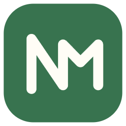
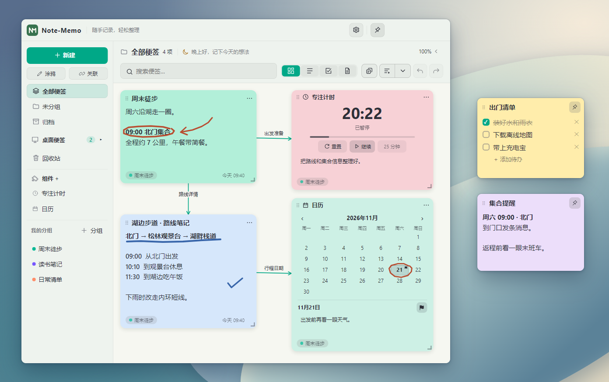
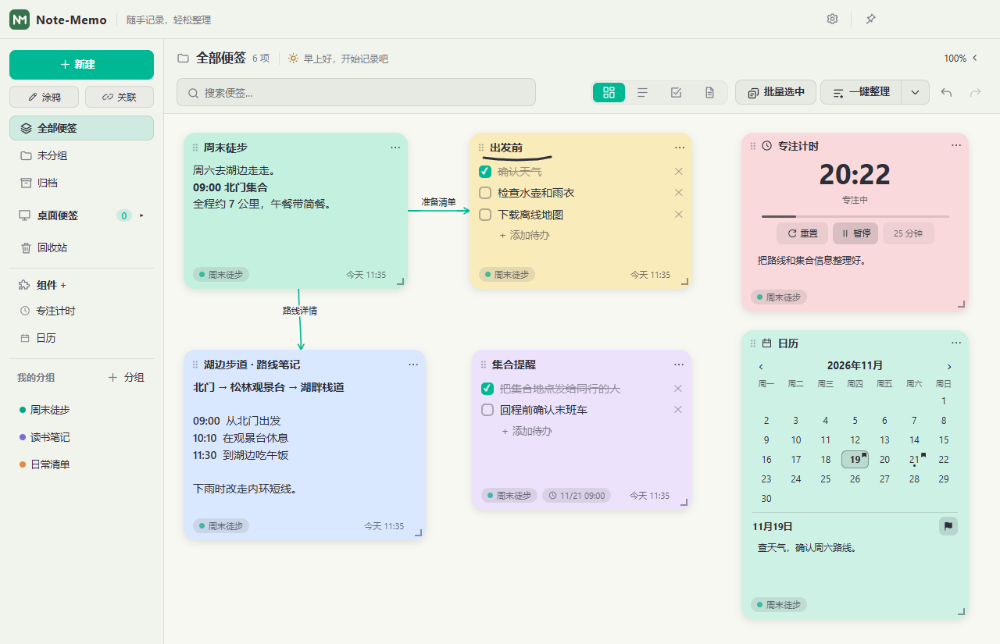
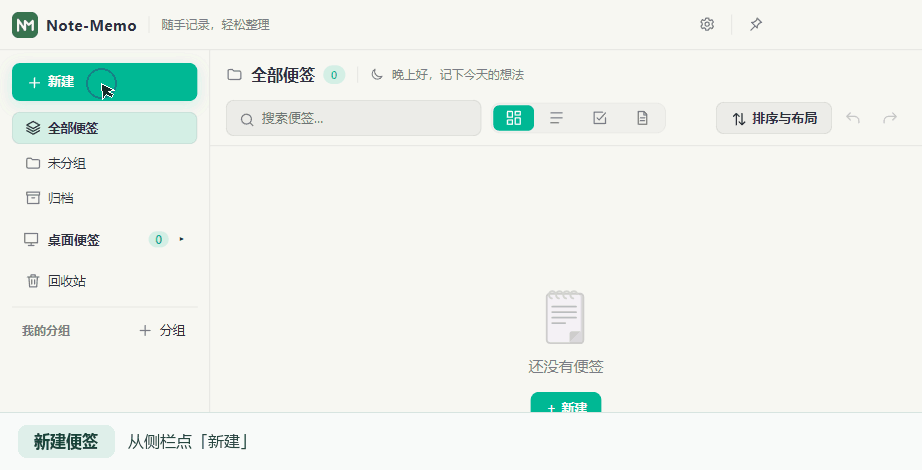
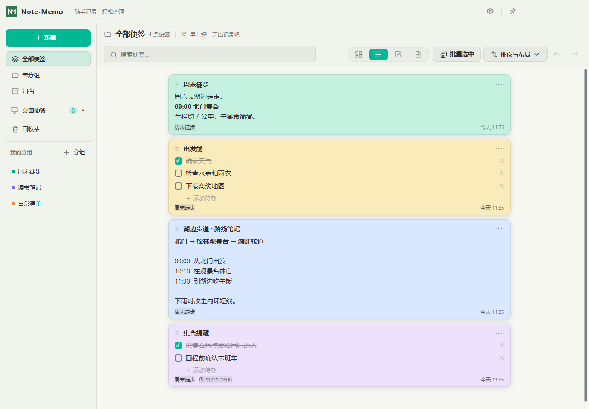
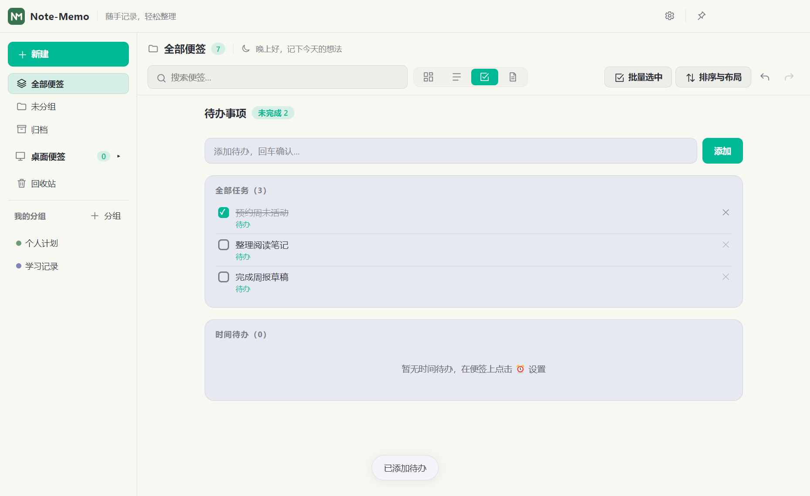
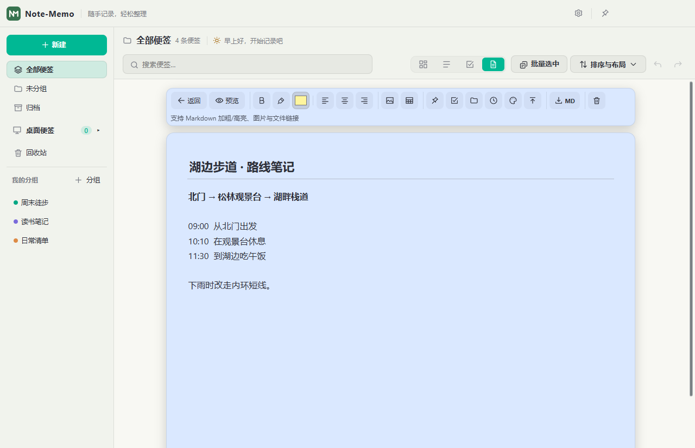
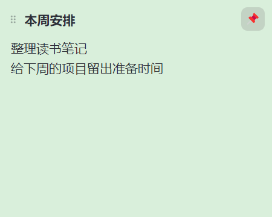
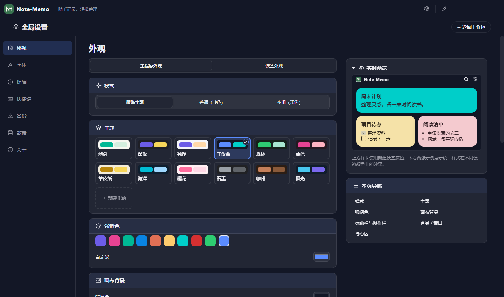

<p align="center">
  
</p>

<h1 align="center">Note-Memo</h1>

<p align="center">
  <a href="./README.md">中文</a> &nbsp;·&nbsp; <strong>English</strong>
</p>

<p align="center">
  <strong>Local-first sticky notes for Windows</strong><br>
  Jot down an idea, pin what matters to your desktop, and organize the rest on a freeform canvas.
</p>

<p align="center">
  <strong><a href="https://github.com/LucasRiver9527/Note-Memo/releases/latest">Download stable release</a></strong>
  &nbsp;·&nbsp;
  <a href="#quick-start">Quick start</a>
  &nbsp;·&nbsp;
  <a href="./CHANGELOG.md">Changelog (Chinese)</a>
  &nbsp;·&nbsp;
  <a href="https://github.com/LucasRiver9527/Note-Memo/issues">Send feedback</a>
</p>

## Example workspace



*The 1.3.2 workspace alongside two notes pinned to the Windows desktop.*



*A closer look at links, checklists, and canvas widgets. You can switch the interface to English in Global Settings.*

## Install and update

**First install.** Download `MyNotes-Setup-*.exe` from **Assets** on the stable release page, then open the installer. You can choose the installation folder. [Download the Windows installer](https://github.com/LucasRiver9527/Note-Memo/releases/latest)

**Updating.** Open **Global Settings → About → Check for updates**, then follow the prompts. You can also download and run the new installer over the existing version. The app stores your notes in a separate user data folder. You can export a backup before updating.

**Windows SmartScreen.** The 1.3.2 installer is unsigned, so Windows may flag it as an unrecognized app. Download it from the official release page and compare the installer’s SHA-256 checksum with the value listed there if you need to verify the file. [Verify the 1.3.2 installer](https://github.com/LucasRiver9527/Note-Memo/releases/tag/v1.3.2) · [Microsoft’s SmartScreen guide](https://learn.microsoft.com/windows/apps/package-and-deploy/smartscreen-reputation)

## Quick start

1. Select **New** in the sidebar or press `Ctrl+Shift+N`. Enter a title and some text.
2. Select the pin on a note or drag the card to **Desktop notes** in the sidebar. Pinned notes can stay on top, snap to screen edges, and be moved or resized. You can also adjust their opacity.
3. When you want to organize several notes, reopen the main window from the system tray and return to the canvas.



## Four ways to work with your notes

| View | When to use it |
| --- | --- |
| **Board** | Arrange cards freely, zoom or pan, and drag a box to select several notes. Alignment guides and gentle snapping help position cards. Hold `Alt` to move freely. |
| **List** | Browse, sort, and edit a set of notes in a list. |
| **Todo** | See checklist items and scheduled reminders together. Check items off or open the source note. |
| **Document** | Open a longer note in an editor, preview it, and export it as Markdown. |

Use colored groups, search, and the archive to organize your notes. Focus the empty search box to find recently edited notes. When you open a note from another view, you can return to the same filters and scroll position. **Quick arrange** arranges the visible notes. You can also save a layout and restore it later. Workspace actions such as moving, grouping, and arranging notes support undo and redo.

Notes support bold text, highlighting, alignment, images, links to local files, and tables with resizable columns, merged cells, and diagonal headers. Markdown export lets you continue writing in another editor. App-specific formatting depends on the editor you use. Scheduled reminders support custom sounds and snoozing while the app runs, including in the system tray.

<details>
<summary>See the list, to-do, document, and desktop note views</summary>

**List view**



**Todo view**



**Document view**



**Desktop note**



</details>

## Canvas features in 1.3.2

- **Link notes.** Connect plans, reference notes, and tasks with labeled arrows that follow the cards when you move them. Keep links visible or show them on hover and focus.
- **Draw on the canvas.** Use a pen or highlighter for quick annotations. Marks drawn on a note move with it. Drawing and erasing support undo.
- **Focus timer and calendar.** Click a widget in the sidebar or drag it onto the canvas. Use the timer to track a session and write a short focus note. Mark dates, write daily notes, and open reminders from the calendar. Both widgets can be colored, grouped, and pinned to the desktop. Changes are shared between the workspace and desktop windows on the same PC.

[Read the full 1.3.2 changelog (Chinese)](./CHANGELOG.md#v132)

## Make it fit your desktop

Choose a light or dark theme, set your own accent and wallpaper, and preview changes in Global Settings. New notes can follow the theme or use a custom color. Adjust fonts, letter spacing, rounded corners, borders, shadows, and opacity. The title bar and notes support an acrylic effect. The interface is available in Chinese and English.



## Your data stays on your PC

Daily use works offline and requires no account. Notes live in your Windows user data folder, separate from the program files. Recover deleted notes from the recycle bin, retry a failed save, or recover unsaved drafts after an unexpected exit.

### Find the data folder

Open **Global Settings → Backup → Open folder**. With the default backup location, File Explorer opens `backups`. Go up one level to find the app’s data folder and `notes-data.json`. If you chose a custom backup path, write it down, clear the backup folder field, and select **Open folder** to locate the default folder.

### Back up and move to another PC

1. On the old PC, open **Global Settings → Backup**. Select **Export now** or **Export to…** and keep the **JSON** file. It contains notes, groups, settings, layouts, and recycle bin entries.
2. Copy any `images`, `backgrounds`, `fonts`, and `sounds` folders you use from the old data folder. Copy files referenced by local links separately, and update the links if the paths change.
3. On the new PC, open Note-Memo, locate its data folder, and back up any notes you want to keep. Quit the app, copy the media into the corresponding subfolders, then reopen it. Select **Import…** in the Backup page, choose the old JSON, and check your notes and media. **Importing replaces the current data.**

<details>
<summary>Default keyboard shortcuts</summary>

| Action | Shortcut |
| --- | --- |
| Show or hide the main window | `Ctrl+Shift+M` |
| Create a note | `Ctrl+Shift+N` |
| Zoom the canvas | `Ctrl+mouse wheel` |
| Pan the canvas | Hold Space and drag with the left button, or drag with the middle button |
| Undo / redo a workspace action | `Ctrl+Z` / `Ctrl+Shift+Z` |
| Bold / highlight | `Ctrl+B` / `Ctrl+H` |
| Align left / center / right | `Ctrl+L` / `Ctrl+E` / `Ctrl+R` |

Open **Global Settings → Shortcuts** to review and customize supported shortcuts.

</details>

## Feedback and development

Feedback and use cases are welcome. When reporting an issue, include the app version, Windows version, steps to reproduce, and what happened. Hide any private notes in screenshots. [GitHub Issues](https://github.com/LucasRiver9527/Note-Memo/issues)

Note-Memo uses Electron and plain HTML, CSS, and JavaScript. To work on it locally, use Node.js on Windows.

```bash
npm ci
npm start
npm run typecheck
npm test
npm run test:e2e
npm run dist
```

`npm run dist` writes the local Windows installer to `release/`.

Note-Memo is available under the [MIT License](./LICENSE).
