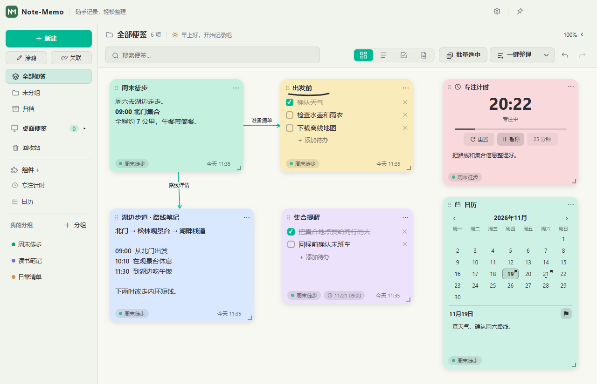
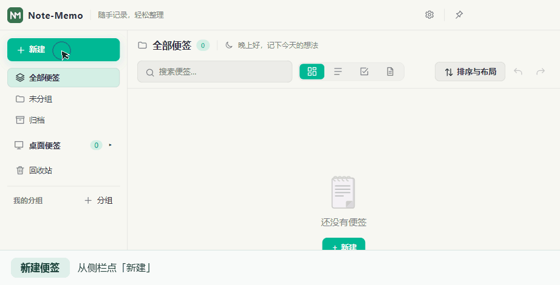
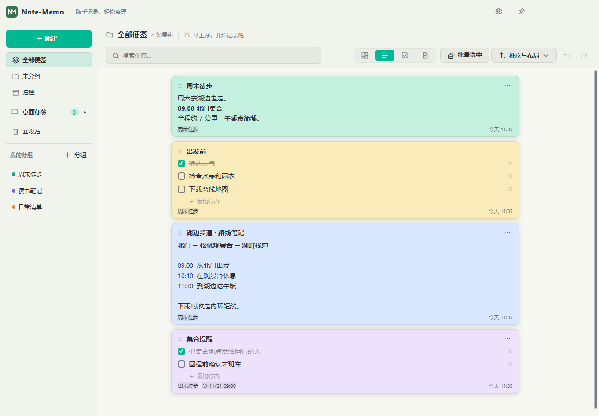
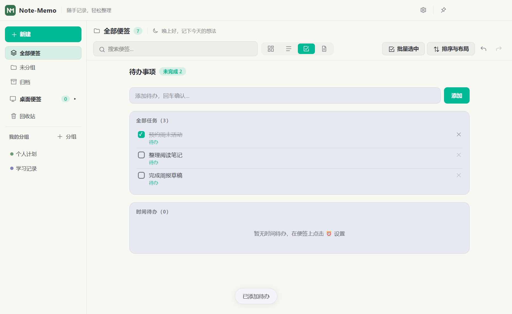
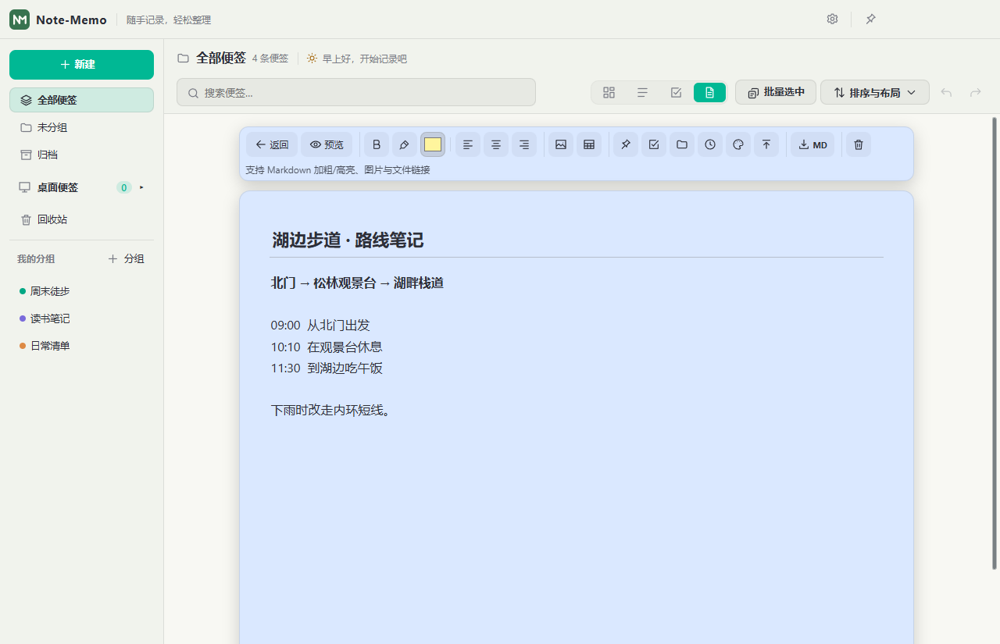
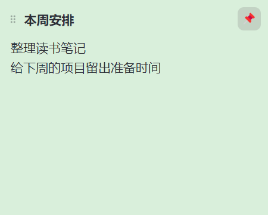
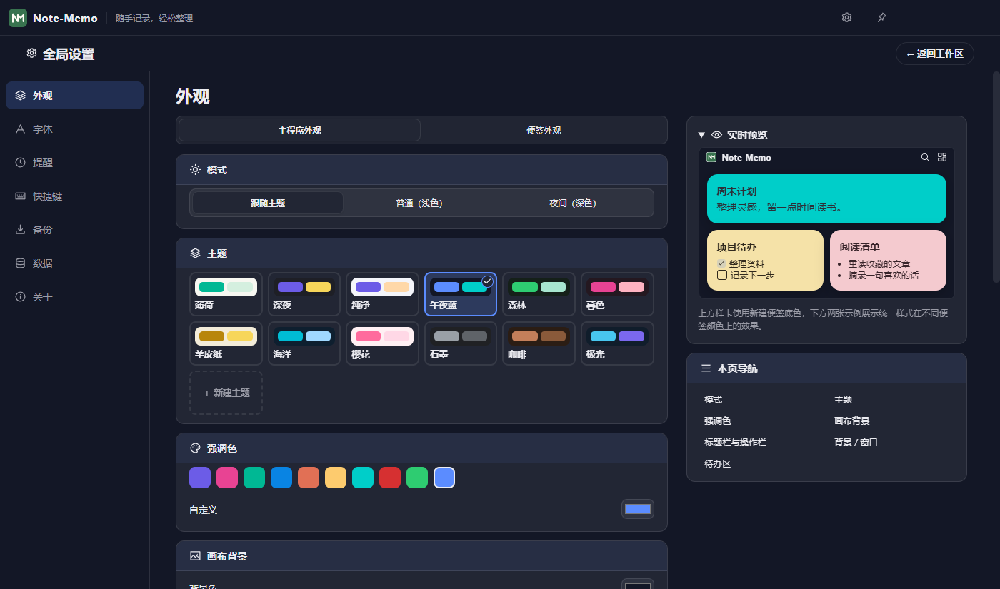

<p align="center">
  
</p>

<h1 align="center">Note-Memo</h1>

<p align="center">
  <strong>中文</strong> &nbsp;·&nbsp; <a href="./README.en.md">English</a>
</p>

<p align="center">
  <strong>本地优先的 Windows 桌面便签</strong><br>
  有个想法就记下来，重要的钉到桌面，攒多了回画布整理。<br>
  Local-first sticky notes for Windows, with desktop pinning, a freeform canvas, and reminders.
</p>

<p align="center">
  <strong><a href="https://github.com/LucasRiver9527/Note-Memo/releases/latest">下载稳定版</a></strong>
  &nbsp;·&nbsp;
  <a href="#快速上手">快速上手</a>
  &nbsp;·&nbsp;
  <a href="./CHANGELOG.md">更新日志</a>
  &nbsp;·&nbsp;
  <a href="https://github.com/LucasRiver9527/Note-Memo/issues">反馈问题</a>
</p>



*上图为 1.3.2 的示例工作区。*

## 安装与升级

**首次安装。** 从稳定版下载页的 **Assets** 下载 `MyNotes-Setup-*.exe`，双击安装。可在安装时选择位置。 [下载 Windows 安装包](https://github.com/LucasRiver9527/Note-Memo/releases/latest)

**已安装旧版。** 打开「全局设置 → 关于 → 检查更新」，按提示下载和安装。也可以从同一下载页取新版安装包覆盖安装。便签数据放在独立的用户数据目录，升级前可以先按下文导出一份备份。

**Windows SmartScreen。** 1.3.2 安装包未签名，Windows 可能提示「无法识别的应用」。请从官方发布页下载。如需核对文件，可比较发布页列出的 SHA-256 校验值。 [核对 1.3.2 安装包](https://github.com/LucasRiver9527/Note-Memo/releases/tag/v1.3.2) · [微软 SmartScreen 说明](https://learn.microsoft.com/windows/apps/package-and-deploy/smartscreen-reputation)

## 快速上手

1. 点侧栏「新建」或按 `Ctrl+Shift+N`，输入标题和正文。
2. 点便签上的图钉，或者把卡片拖到侧栏的「桌面便签」。钉住的便签可置顶、拖动、调整大小和透明度，也能贴靠屏幕边缘。
3. 要整理多张便签时，从系统托盘唤回主窗口，回到画布。



## 同一组便签，四种整理方式

| 视图 | 什么时候用 |
| --- | --- |
| **便签画布** | 自由拖放、缩放平移、框选多张便签。拖动时有辅助线和轻吸附，按住 `Alt` 可自由摆放 |
| **备忘录** | 集中浏览一组便签，按顺序查找或继续编辑 |
| **待办** | 汇总各张便签的任务和时间提醒，直接勾选或打开来源便签 |
| **文档** | 展开长笔记，编辑、预览并按篇导出 Markdown |

用颜色分组、搜索和归档整理便签。聚焦空搜索框可打开最近编辑的内容，从其他视图进入详情后，可以回到原来的筛选和位置。「一键整理」只排列当前可见便签，也可保存自己排好的布局供日后恢复。移动、分组和整理等工作区操作支持撤销、重做。

正文支持加粗、高亮、对齐、图片、本地附件链接和轻量表格。表格支持调整列宽、合并单元格及斜线表头。导出 `.md` 后，可以在其他编辑器继续写，特有样式的还原程度取决于编辑器支持情况。定时提醒支持自定义提示音和稍后再响，应用留在系统托盘时也可提醒。

<details>
<summary>查看备忘录、待办、文档和独立桌面便签</summary>

**备忘录**



**待办**



**文档**



**独立桌面便签**



</details>

## 1.3.2 画布新功能

- **关联便签**。把计划、资料和待办连起来，在线上写明关系。拖动便签时连线跟着走，可以选择常驻显示或只在悬停、聚焦时显示。
- **画布涂鸦**。用画笔和马克笔圈重点、做批注，工具栏按需展开。画在便签上的笔迹会随卡片移动，绘制和擦除都能撤销。
- **专注计时与日历**。从侧栏点击或拖入组件。专注计时支持自定义时长和多行备注，日历支持日期标记、逐日记录，并能打开当天有提醒的便签。两种组件都能改色、分组和钉到桌面，记录在同一台电脑的工作区与独立窗口间同步。

[查看 1.3.2 完整更新说明](./CHANGELOG.md#v132)

## 把外观调成你喜欢的样子

在全局设置里切换浅色、深色和预设主题，或用自己的配色与背景图。新便签底色可跟随主题，也可以单独设定。便签的字体、字距、圆角、边框、阴影和透明度都能调整，标题栏和便签可启用亚克力效果。设置页会实时预览，界面支持中文和英文。



## 数据留在本机

日常记录无需联网或注册账号。便签保存在 Windows 用户数据目录，和安装目录分开。删除的便签可从回收站找回。保存失败时可重试，异常退出后可尝试恢复尚未保存的草稿。

### 找到数据目录

打开「全局设置 → 备份 → 打开文件夹」。使用默认备份目录时，资源管理器会打开 `backups`，返回上一级就是应用的数据目录，其中的 `notes-data.json` 是便签存档。如果设置过自定义备份目录，可以先记下原路径，将「备份文件夹」留空，再点「打开文件夹」定位默认目录。

### 备份与迁移

1. 在旧电脑打开「全局设置 → 备份」，点「一键导出」或「导出到指定位置」，保留 **JSON**。它包含便签、分组、设置、布局和回收站记录。
2. 如果用过应用内图片、背景、自定义字体或提示音，把旧数据目录中存在的 `images`、`backgrounds`、`fonts`、`sounds` 一起备份。通过链接引用的本地附件也要另行搬运，路径变了需要重新挂上。
3. 在新电脑启动 Note-Memo，先确认新数据目录，并备份需要保留的现有数据。退出应用后，把媒体文件复制进新数据目录下相应的子文件夹。重新打开应用，在备份页选「导入备份…」，选择旧电脑导出的 JSON，再检查便签和媒体。**导入会替换当前数据。**

<details>
<summary>默认快捷键</summary>

| 操作 | 快捷键 |
| --- | --- |
| 显示或隐藏主窗口 | `Ctrl+Shift+M` |
| 新建便签 | `Ctrl+Shift+N` |
| 缩放画布 | `Ctrl+滚轮` |
| 平移画布 | 空格 + 左键拖动，或中键拖动 |
| 撤销 / 重做工作区操作 | `Ctrl+Z` / `Ctrl+Shift+Z` |
| 加粗 / 高亮 | `Ctrl+B` / `Ctrl+H` |
| 左对齐 / 居中 / 右对齐 | `Ctrl+L` / `Ctrl+E` / `Ctrl+R` |

可在「全局设置 → 快捷键」查看和修改支持改键的操作。

</details>

## 反馈与开发

欢迎分享用法和改进建议。报告问题时，请附上应用版本、Windows 版本、复现步骤与实际结果，发截图前记得遮住私人便签。 [前往 GitHub Issues](https://github.com/LucasRiver9527/Note-Memo/issues)

项目基于 Electron 和原生 HTML、CSS、JavaScript。可在 Windows 上用 Node.js 本地运行。

```bash
npm ci
npm start
npm run typecheck
npm test
npm run test:e2e
npm run dist
```

`npm run dist` 将本地安装包输出到 `release/`。

Note-Memo 使用 [MIT 许可证](./LICENSE)。
